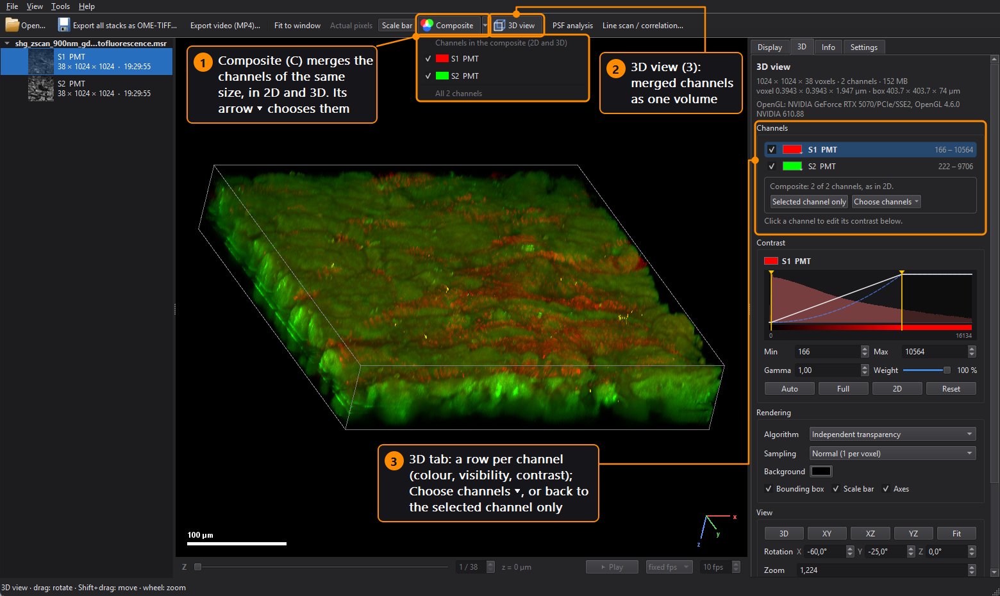

# Changelog

Ready-to-run apps for each version: [releases](https://github.com/manuel-kunisch/imspector-msr-viewer/releases).

## v0.6.1 (2026-11-26): fixes

- Greyed-out menu entries are drawn grey in the dark theme. Before, a white shadow made them look brighter
  than the active ones (e.g. the header and *All N channels* in the Composite menu).
- Line scan: the tooltip of *Align to first stack* says cross-correlation, as the code does it.
- README: a line scan screenshot (170 nm beads), and all screenshots in the app's dark theme.

## v0.6.0 (2026-11-26): 3D view

- **3D view** (View ▸ 3D view, key 3) of z-stacks and 3D mosaics: interactive volume rendering on the graphics
  card, a Python port of the renderer of the Fiji plugin [3Dscript](https://github.com/bene51/3Dscript)
  (Schmid et al., Nat. Methods 2019; BSD 2-Clause).
  - Mouse: drag rotates, Shift+drag moves, the wheel zooms about the cursor; keys R / Home, F, arrows, + / −.
  - Per channel: a colour or a lookup table (Fire, Viridis, HiLo, Inverted), Min / Max on the histogram of the
    whole volume, gamma, weight, visibility; Auto, Full, 2D and Reset.
  - Independent transparency, combined transparency and maximum intensity projection; sampling Fast / Normal /
    Fine; background colour, bounding box, scale bar and axes.
  - View presets 3D, XY, XZ, YZ, Fit; rotation angles and zoom as numbers.
  - The volume loads in the background with progress and Cancel; resolution Auto, Full, ½, ¼.
  - Save PNG at full quality with the overlays, or copy the image.
- **Several channels in 3D through Composite.** The 3D view shows what the 2D view shows: with Composite off
  only the selected channel, with Composite on the channels of the composite. When a file has more channels
  of the same size, the 3D tab says how many are shown and offers *Show all N channels*; the status bar says
  so when 3D is switched on. See [Several channels in 3D](README.md#several-channels-in-3d).
- **Choose the channels of the composite**: the arrow ▾ next to the *Composite* button, View ▸ Composite
  channels and *Choose channels* in the 3D tab open a menu with a tick box per channel; the tick boxes of the
  composite table do the same. All channels of the same size are merged at first, one always stays.
  Switching Composite on in 3D keeps the 3D tab in front.
- OpenGL 3.3 through PyQt5 alone (no new dependency); macOS uses an OpenGL 4.1 core profile.
  `MSR_VIEWER_SOFTWARE_GL=1` selects Qt's software renderer on Windows where no graphics driver is available.
- Help ▸ Third-party notices; THIRD_PARTY_NOTICES.md with the 3Dscript license.

## v0.5.0 (2026-11-26): compressed files, mosaics and stitching

- Files saved compressed by ImSpector open like any other.
- Mosaics (tile scans) as one stack: tiles at their stage positions, or stitched (overlaps registered in 2D
  or 3D, all shifts solved together, inconsistent ones dropped) and blended (linear feathering, average,
  maximum, none). The Mosaic tab has the options, the overlap and tile tables and tile outlines.
- TIFF, PNG and MP4 export of the fused mosaic as shown; `python msr_mosaic.py file.msr --align` on the
  command line.
- macOS (Apple Silicon) app and DMG (build_macos.sh).

## v0.4.0 (2026-10-02): TIFF files, calibration, composite

- TIFF, OME-TIFF and ImageJ files next to `.msr` files, with the same tools.
- Tools ▸ Calibration for TIFFs without pixel size, z step or frame interval.
- Composite (View ▸ Composite, C): the channels of a file merged, each with its own colour and levels; also in
  PNG and MP4 export.

## v0.3.1 (2026-09-25)

- Windows app (PyInstaller, build_windows.ps1) and a new app icon.

## v0.3.0 (2026-09-25): video export, PSF analysis, line scan

- Real-time playback and MP4 export with the recorded frame timing (× speed), or at a fixed frame rate.
- PSF analysis (Tools ▸ PSF analysis): lateral and axial widths at FWHM, 1/e or 1/e² from threshold crossings
  and a Gaussian fit.
- Line scan / correlation between chosen stacks (Tools ▸ Line scan): profiles along a line, Pearson r,
  sub-pixel alignment.

## v0.2.1 (2026-09-25)

- Frame times as plain text, one value (s) per line.
- Windows: paths beyond 260 characters.

## v0.2 (2026-09-24)

- First version: reader, OME-TIFF / ImageJ TIFF export with metadata.json, and the viewer.
