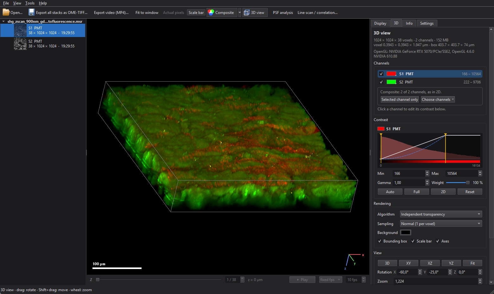
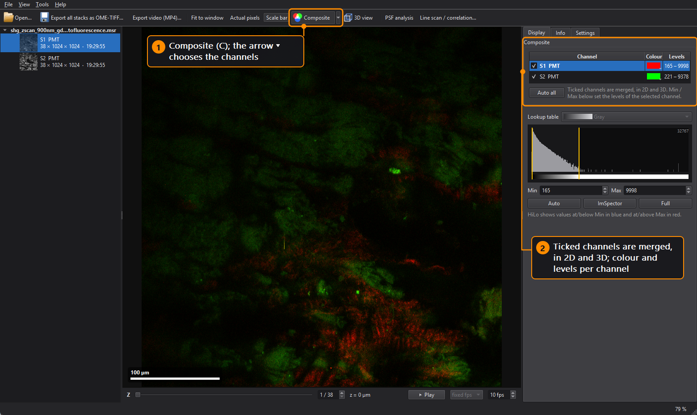
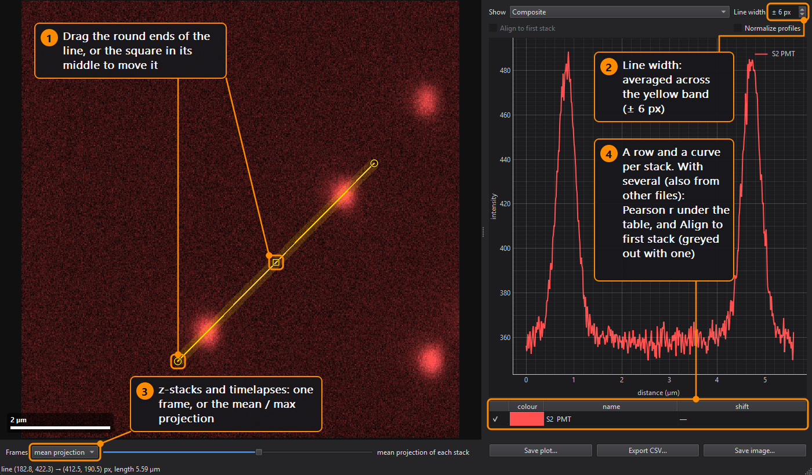
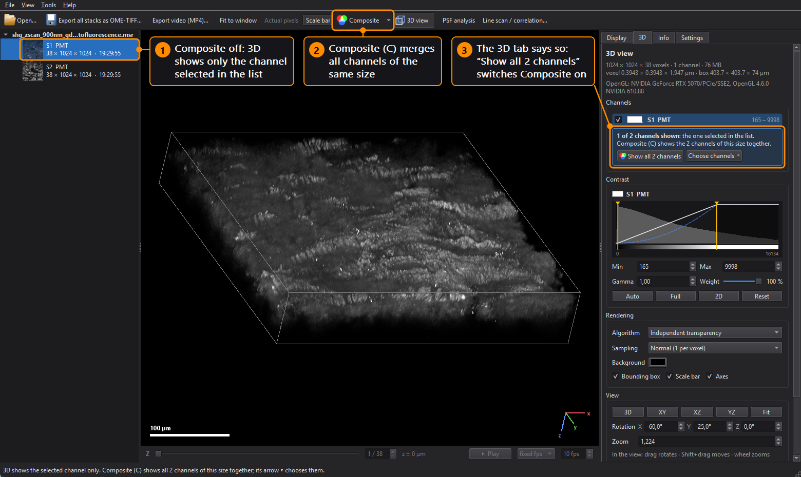
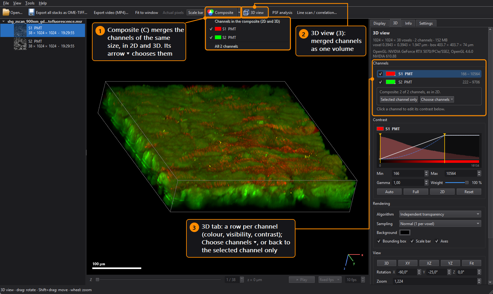

# imspector-msr-viewer

Viewer and TIFF exporter for LaVision BioTec **ImSpector** `.msr` files (ImSpector Pro 7.x, TriM Scope).
Bio-Formats rejects these files ("Unknown file format"), so this reads them directly. No ImSpector needed.

> [!TIP]
> **Ready-to-run apps, no Python needed:** download them from the
> [latest release](https://github.com/manuel-kunisch/imspector-msr-viewer/releases/latest).
>
> - **Windows 10/11 (64-bit):** `MSR_Viewer_v<version>.zip`, unzip it and start `MSR_Viewer.exe`
> - **macOS (Apple Silicon, macOS 14 or newer):** `MSR_Viewer_AppleSilicon_v<version>.dmg`, drag *MSR Viewer*
>   onto *Applications*
>
> The apps are not signed with a developer certificate, so the first start needs one confirmation:
> *More info* ▸ *Run anyway* on Windows, System Settings ▸ Privacy & Security ▸ *Open Anyway* on macOS.


> **v0.6.0, in development.** Tested so far with ImSpector Pro 7.6.4 files (camera, PMT and resonant
> scanner timelapse, compressed files, a 3 × 3 mosaic of z-stacks). Other acquisition types may not work yet.
> What changed in each version: [CHANGELOG.md](CHANGELOG.md).



## Features

- Drag & drop `.msr` files or folders into the viewer, also files saved compressed by ImSpector
- Overview of all stacks in the measurement workspace
- Mosaics (tile scans) as one image: the tiles placed at their stage positions, or stitched (the overlaps
  registered by cross-correlation in 2D or 3D, all shifts solved together, inconsistent ones dropped) and
  blended (linear feathering, average, maximum or none); saved as OME-TIFF / ImageJ TIFF, PNG or as MP4
  (z sweep or timelapse) like any other stack
- Zoom/pan, scale bar, LUTs, histogram/contrast, frame slider
- Composite (View ▸ Composite, C): the channels of a file merged as in ImageJ's composite mode, each with its
  own colour and levels; the arrow ▾ next to *Composite* chooses which channels are merged; also for PNG and
  MP4 export and in the 3D view
- 3D view (View ▸ 3D view, 3) of z-stacks and 3D mosaics: interactive volume rendering on the graphics card,
  a Python port of the renderer of the Fiji plugin [3Dscript](https://github.com/bene51/3Dscript); per channel
  colour or lookup table, min / max, gamma and weight, three rendering algorithms, view presets, PNG snapshots;
  several channels together with Composite ([how](#several-channels-in-3d))
- Timelapse playback in real time (the recorded frame intervals, × speed) or at a fixed frame rate
- All metadata: pixel size, frame timestamps, objective and every ImSpector setting (filter, compare two stacks)
- Export to OME-TIFF or ImageJ TIFF with physical pixel size and frame times, plus a `metadata.json`
- Frame times as plain text, one value (s) per line
- MP4 video of a timelapse or z sweep: real acquisition timing (× speed, e.g. 0.25 = four times slower)
  or a fixed frame rate, with optional scale bar and time stamp
- Pixel data is exported bit-exact, no rescaling
- PSF analysis on demand (Tools ▸ PSF analysis): click a bead, get lateral x/y and (for z-stacks) axial
  widths at FWHM, 1/e or 1/e², from the threshold crossings and a Gaussian fit
- Line scan / correlation on demand (Tools ▸ Line scan / correlation…): pick stacks (also from different files), compare
  their profiles along a line, Pearson r along the line and over the image, optional sub-pixel alignment;
  per frame or as mean / max projection; plot (PNG/PDF/SVG), CSV and image export
- TIFF, OME-TIFF and ImageJ TIFF files open next to `.msr` files for the same viewing and analyses (PSF,
  line scan across both, video, frame times); calibration and frame times are used where the file has them,
  missing ones can be set (Tools ▸ Calibration)

## Install

Python ≥ 3.10 with numpy, tifffile and PyQt5, plus pyqtgraph and imageio-ffmpeg for the tools and the
video export, for example:

    conda create -n msr -c conda-forge python=3.12 numpy tifffile pyqt pyqtgraph imageio-ffmpeg scipy scikit-image matplotlib

Tested with numpy 1.26–2.5, tifffile 2023.4–2026.6 and PyQt5 5.15.
numpy, tifffile and pyqt are enough to view (also in 3D), stitch and save TIFFs. The PSF analysis and the line
scan need pyqtgraph (it brings colorama along); video export needs ffmpeg, which imageio-ffmpeg bundles (or any ffmpeg
on PATH). scipy, scikit-image and matplotlib are optional (Gaussian fit, spline sampling, sub-pixel alignment,
plot export; scipy also speeds up the stitching filter). An existing environment gets them with
`conda install -n msr -c conda-forge pyqtgraph imageio-ffmpeg scipy scikit-image matplotlib`.
Packages installed with `pip install --user` are seen by every environment of the same Python version and can
hide what an environment itself lacks.

## Standalone apps

Windows:

    powershell -ExecutionPolicy Bypass -File build_windows.ps1

builds `dist\MSR_Viewer_v<version>\MSR_Viewer.exe` and a zip of that folder (PyInstaller, one-folder build, no
Python needed on the target PC). The script creates its own `.venv-build` from Python 3.12 (py launcher) with the
packages from requirements.txt, so the exe only contains what the viewer imports: about 320 MB unpacked, mostly
ffmpeg, Qt and scipy. `-SkipInstall` reuses the venv as it is, `-NoZip` skips the zip. Drop .msr or TIFF files
onto the exe or use "Open with".

macOS (Apple Silicon), in Terminal on the Mac:

    ./build_macos.sh

builds `dist/MSR Viewer.app` and `dist/MSR_Viewer_AppleSilicon_v<version>.dmg`, in its own `.venv-build-macos`
from a native arm64 Python 3.10+ (`PYTHON=...` picks one; Xcode command line tools needed, `brew install
create-dmg` optional for a nicer DMG window). `--skip-install` reuses the venv. The app icon comes from
`msr_viewer.png` if present (logo at 1024 px for sharp Retina icons), else from `msr_viewer.ico`. The app is
signed ad hoc only, so macOS asks once: System Settings ▸ Privacy & Security ▸ Open Anyway, or
`xattr -dr com.apple.quarantine "/Applications/MSR Viewer.app"`. Open With and dropping files onto the Dock
icon work for .msr and TIFF files.

## Usage

Viewer:

    python msr_viewer.py [file.msr | file.tif ...]

On Windows you can also drop files onto `MSR_Viewer.bat`. It uses the conda environment named `msr` (in
`%USERPROFILE%\.conda\envs`, `anaconda3`, `miniconda3`, `miniforge3` or ProgramData), or the one the
environment variable `MSR_VIEWER_ENV` points to.
Wheel = zoom, drag = pan, double-click = fit, ←/→ = frame, Space = play.
Next to the play button you choose *real time* (with a speed factor) or *fixed fps*; File ▸ Export video
writes the same as MP4. In real time each frame is held for its recorded interval; the file itself has a
constant frame rate (60 fps by default), so it plays everywhere and the timing is exact to one video frame.

Mosaics: when a file contains the tiles of a mosaic (ImSpector "2D Mosaic", one stack per tile), the viewer
adds a stack *Mosaic 3 × 3 PMT:0:4* (one per detector) and opens it. The *Mosaic* tab next to *Display*
switches between

- the **stage positions** recorded by ImSpector (stage +X to the right, +Y up, as in ImSpector; *Detect*
  tries all eight orientations if another setup differs), and
- **Stitch**: every overlap of neighbouring tiles is registered (high-pass filtered, so the small structures
  count and not the background; the best of several cross-correlation peaks by normalised cross-correlation,
  sub-pixel). *3D: all planes* uses the whole overlap volume of a z-stack (most robust; optionally with a z
  shift between tiles), *2D* the maximum projection or the plane shown. Overlaps with a correlation below
  *Min. correlation* are not used. Where a grid step (column c → c + 1) has three or more overlaps, one
  that is far off the others (more than half the search range, or four robust standard deviations of that
  step) is dropped: a stage tends to repeat its error for the same move, a false peak in an overlap without
  structure lands anywhere in the search range. All links are then solved together (weighted least squares; a tile without a usable overlap follows
  the median error of its grid step, a tile without any overlap stays at its stage position) and links
  that still disagree by more than 3 px are dropped. The table lists every overlap (shift against the
  stage, correlation r, used or why not) and every tile.

Blending: linear feathering across the overlap (hides intensity steps at the seams), average, maximum, or
none (later tiles on top, to inspect the seams). Tiles are placed on whole pixels by default, so every pixel
outside the overlaps keeps its raw value; *Sub-pixel placement* interpolates instead. *Tile outlines* draws
the tiles on the image; the status bar names the tile(s) under the cursor. The fused mosaic is composed
plane by plane from the memory-mapped tiles when shown or saved (≈ 25 ms per 1440 × 1470 plane); the
planes last used are cached, up to 256 MB per view or export (so a small mosaic like the sample, 90 MB,
ends up cached as a whole). *Save TIFF*,
*Video* and *PNG* (or File ▸ Save current stack / Export video) write it as shown, with the layout of the
moment the export starts; Export all stacks also writes every mosaic next to the tiles. Videos of large
mosaics can be written at half or quarter size.

On the 3 × 3 sample (10 % overlap) the tiles are up to ≈ 30 px (23 µm) away from their stage positions
(scan field rotated by ≈ 1.4° against the stage). Stitched in 3D (the default for z-stacks, ≈ 3 s) all
twelve overlaps are used and agree to within 0.6 px; the 2D maximum projection (0.25 s) uses eight of them
(three are too weak, one false peak in the empty corner tile is dropped) and places every tile within
1.3 px of the 3D result.

Composite merges the stacks of a file that have the same axes and size (the detectors of one acquisition, the
channels of a TIFF), each scaled to its own levels and added in its own colour, as ImageJ does (red, green,
blue, gray, cyan, magenta, yellow; the colour button picks another). A click on a channel in the table makes
Min / Max and the histogram below act on it; frame and zoom stay. Save view as PNG and Export video write
the composite; the PSF tab measures the selected channel.

All channels of the same size are merged at first. To leave some out, untick them in the table, or tick the
ones you want in the menu of the arrow ▾ next to the *Composite* button (also View ▸ Composite channels and
*Choose channels* in the 3D tab). The menu stays open while you tick; choosing channels there switches
Composite on, and one channel always stays in. The choice holds for 2D, the exports and the 3D view.



PSF analysis opens as an extra tab. A click on a bead snaps the cross to its centre (brightest pixel nearby,
refined by the intensity centroid); drag the white circle to fine-tune. The profiles along both arms are
sampled with cubic splines (bilinear sampling between pixel centres would broaden a PSF by ~2 % at σ = 2 px),
optionally averaged over parallel lines and rotated. Widths are measured above a baseline (profile ends,
a movable background box, or zero); for z-stacks the axial profile is the mean of a small box in every slice.
Results can be copied or saved as CSV / PNG.

Line scan / correlation (Tools ▸ Line scan / correlation…, Ctrl+Shift+L) first asks which stacks to compare
(same X × Y size), then opens its own window: a composite (or one stack at a time) with a line whose ends and
centre can be dragged, the profiles of all stacks along it (optionally averaged over a band and normalized),
and Pearson r for every pair. *Align to first stack* registers each stack to the first one by
cross-correlation of lightly smoothed, Hann-windowed images with sub-pixel refinement (within 0.02 px on
synthetic shifts; plain phase correlation without a window can be off by pixels because of the image edges).
Names and colours are editable in the table. Z-stacks and timelapses are scanned in one frame or in the mean
or maximum projection of each stack. *Save plot…* writes PNG, PDF or SVG, *Export CSV…* the profiles with the
line and the settings, *Save image…* the view with the line and a scale bar. Below, two 170 nm beads 3.9 µm
apart in a z-stack of 101 planes with 17 nm pixels, scanned in the mean projection over ± 6 px:



TIFF files (`msr_tiff.py`): every channel of every image series becomes a stack, like the detectors of an
`.msr`. Pixel size, z step, frame interval, per-frame times and channel names come from the OME-XML, the
ImageJ metadata (unit, spacing, finterval) or the resolution tags (only cm / mm / µm, a dpi value is not a
calibration). The exports of this tool come back with all ImSpector metadata and settings. Without any axis
information the pages are taken as Z slices, as ImageJ and Bio-Formats do. Tools ▸ Calibration makes them
time points and fills in a missing pixel size, z step or frame interval (until the file is closed; Save
stack writes it into an OME-TIFF). Uncompressed data are
memory-mapped, also when written page by page as cameras do; LZW / JPEG compressed TIFFs need
`pip install imagecodecs`. Export all stacks stays an `.msr` function, single TIFF stacks can be saved again.

Export without GUI:

    python msr_mosaic.py file.msr --align        # each mosaic stitched (3D for z-stacks, linear blend) as OME-TIFF
    python msr_mosaic.py file.msr --info         # only list the mosaics and their tiles (with --align: overlaps)
    python msr_reader.py file.msr                # OME-TIFFs, frame times + metadata.json into file_tiff/
    python msr_reader.py folder --imagej         # every .msr in a folder, as ImageJ hyperstacks
    python msr_reader.py file.msr --timestamps   # only the frame times as text, one per line
    python msr_reader.py file.msr --info         # only list what is inside

From Python:

```python
from msr_reader import MSRFile

with MSRFile("file.msr") as msr:
    for s in msr.stacks:
        print(s.source, s.axes, s.shape, s.pixel_size)
        data = s.asarray()   # numpy memmap, nothing is loaded until you index it

import msr_mosaic as mm

with MSRFile("mosaic.msr") as msr:
    for m in mm.find_mosaics(msr):
        m.set_registration(m.register(mm.RegistrationOptions(source="volume")))  # stitch
        plane = m.stack.asarray()[10]   # fused plane 10 (linear blend)
        print(mm.report(m))
```

## 3D view

View ▸ 3D view (key 3, or *3D view* in the toolbar) shows the current z-stack or 3D mosaic as a volume. Every
pixel of the view casts a ray through the stack on the graphics card (orthographic ray casting), a Python port
of the renderer of the Fiji plugin 3Dscript (see below). While Composite is on, the channels of the
composite are shown together; otherwise the stack the 2D view shows (see
[Several channels in 3D](#several-channels-in-3d)). The button stays on while 2D-only stacks are shown, and
the next z-stack opens in 3D again. Other axes such as time are chosen with the sliders below the view as in
2D. The Z slider is off, because all planes are shown.

### Several channels in 3D

> [!IMPORTANT]
> The 3D view shows what the 2D view shows. With Composite off, that is **only the channel selected in the
> list**, even when the file has more channels. To see several channels in 3D, switch **Composite** on: the
> toolbar button, View ▸ Composite or the key **C**, before or after switching to 3D, or *Show all N
> channels* in the 3D tab.

When the file has more channels of the same size, the 3D tab says how many are shown, and the status bar
says so when 3D is switched on:



With Composite on, each channel of the composite becomes a channel of the volume, with its composite colour
and its 2D Min / Max to start with. All channels of the same size are in it at first. The arrow ▾ next to
*Composite*, View ▸ Composite channels or *Choose channels* in the 3D tab tick which ones are merged; the
volume reloads with them. *Selected channel only* switches Composite off again. The tick box in front of each
channel row of the 3D tab hides a channel in 3D without loading the volume again (2D is not affected).



Mouse and keys in the view:

- drag: rotate (the front of the volume follows the mouse; with Alt or Ctrl about one axis only)
- Shift+drag or middle-button drag: move
- wheel: zoom about the cursor (wheel up zooms in, as in 2D); + / −: zoom
- arrow keys: rotate by 5° (Shift: 1°); R or Home: the oblique 3D view; F: fit; B: scale bar

The *3D* tab next to *Display*:

- **Channels**: visibility and colour per channel: a colour, or one of the lookup tables Fire, Viridis, HiLo
  and Inverted. A channel starts with its colour in 2D (composite colour or LUT) and its 2D Min / Max. Click a
  channel to edit its contrast. Below the channels, when the file has more channels of this size: how many
  are shown, *Show all N channels* / *Selected channel only* and *Choose channels*.
- **Contrast**: the histogram of the whole volume with the transfer function. Drag the yellow lines to set
  Min / Max, or drag between them to move the window. Below Min a voxel is black and transparent; towards Max
  it gets its full colour and becomes opaque. Gamma (brightness curve), Weight, and the buttons Auto (0.1–99.9 %
  of the volume, Shift+click: all channels), Full, 2D (the Min / Max of the 2D view) and Reset.
- **Rendering**: algorithm, sampling (samples per voxel along each ray: Fast, Normal, Fine), background
  colour, bounding box, scale bar and axes.
- **View**: the presets 3D (oblique, from above the front), XY (as the 2D view), XZ, YZ and Fit; the rotation
  angles (3Dscript's Euler angles) and the zoom.
- **Volume**: the resolution on the graphics card; *Save PNG…* (also File ▸ Save view as PNG) and *Copy image*
  render the view at full quality with its overlays.

Rendering algorithms, as in 3Dscript:

- **Independent transparency**: every channel is composited front to back with its own opacity, so a channel
  in front does not hide another channel behind it.
- **Combined transparency**: the opacities of all channels add up along the ray, so the first structure in
  front hides what lies behind it, whatever its channel.
- **Maximum intensity**: the brightest value along each ray. The XY view is the same as a maximum projection
  of the stack.

The volume is read in the background (progress and Cancel in the 3D tab). After Cancel, or when it could not
be loaded, the view stays empty (it does not show the previous stack instead) and *Reload* in the 3D tab tries
again; only a change of the resolution keeps the volume shown, at its resolution. With resolution *Auto*, a
channel larger than 64 M voxels is averaged down in x and y (in z only if needed). *Full* keeps every voxel, up to the texture size limit of the graphics card and at most 512 M voxels
per channel and 1 G over all channels (beyond that x and y are averaged further; the 3D tab says "capped");
½ and ¼ are faster on large stacks. While the view moves it is drawn coarser, then once at full quality. When
3D is switched off, a volume of up to 1 GB stays loaded, so it is back at once; a larger one is released.

Not in this version yet: editing the opacity curve (it follows Min / Max with gamma 2, as 3Dscript starts),
lighting, cropping, animations (3Dscript's scripting) and perspective projection.

The 3D view needs OpenGL 3.3 (3.0 is accepted), which every graphics driver of the last decade provides
(macOS: OpenGL 4.1). Where OpenGL is missing or too old, for example over remote desktop or in a virtual
machine, the viewer says so when 3D is switched on. On Windows, the environment variable
`MSR_VIEWER_SOFTWARE_GL=1` then selects Qt's software renderer (Mesa llvmpipe, OpenGL 3.0), for example
`set MSR_VIEWER_SOFTWARE_GL=1` before starting `MSR_Viewer.exe`. It runs on the processor and is much slower
than a graphics card (often 10–100 times: fine for small stacks and occasional use). It works in the packaged
Windows app and with PyQt5 from pip, which include it (`opengl32sw.dll`). conda-forge's Qt is built for desktop
OpenGL only and ignores the variable (Anaconda's own Qt honours it only in an activated environment), and
macOS has no software renderer.

**Acknowledgement.** The 3D view is a port of the interactive renderer of 3Dscript by Benjamin Schmid,
<https://github.com/bene51/3Dscript>, used under the BSD 2-Clause License (full text in
[THIRD_PARTY_NOTICES.md](THIRD_PARTY_NOTICES.md), also shown by Help ▸ Third-party notices in the viewer and
the app). If you use the 3D view, please cite:

> Schmid B, Tripal P, Fraaß T, Kersten C, Ruder B, Grüneboom A, Huisken J, Palmisano R. 3Dscript: animating
> 3D/4D microscopy data using a natural-language-based syntax. *Nat Methods* 16, 278–280 (2019).
> <https://doi.org/10.1038/s41592-019-0359-1>

## How the file is read

An `.msr` file is the ImSpector workspace (e.g. "Measurement 1") written with Microsoft's MFC `CArchive`
serialization. It is one continuous little-endian object stream, with no offset table and no markers, so it
has to be read front to back, object by object:

- Every object starts with a tag. The first time a class appears, the tag is `FF FF` followed by the schema
  and the class name (e.g. `CDataStack`). After that it is `0x8000 | class index` (e.g. `3D 82`).
- Classes and objects share one running index. Every object has to be counted (each single setting is an
  object), otherwise later tags point to the wrong class.
- Strings are length-prefixed MFC `CString`s, and lists are `count + items`.
- A setting (`CProperty`) is `key, type, label, group, flags, value`. The type says how the value is
  stored: 1 = double, 2/4 = int32, 3 = float, 5 = string.

The stream is divided like this:

```
int32              file version (8)
settings list      count + CProperty × n          global instrument settings (571 here)
workspace fields
stack array        count, then per stack:
  CDataStack         the acquired data        <- pixels live here
  CImageStack        how ImSpector displayed it (LUT, zoom), no pixels
CChildFrame array  window layout
CPropArray         property set of the workspace
```

Inside a `CDataStack`:

```
base header   name, time, source ("Camera", "PMT", "ResonantPMT"), "Key::Value::" metadata
stack header  units, per-frame timestamps (float32), offsets, ...
data array    channel id   "PMT[1]:0:4:0"
              sizes[4]     X, Y, dim3, dim4          e.g. 256, 256, 250, 1
              lengths[4]   physical extent (µm, s)
              labels[4]    "ResonantPMT X", "ResonantPMT Y", "Time T", "None"
              pixels       X·Y·dim3·dim4 × uint16, little-endian, X fastest
settings      count + CProperty × n        snapshot of all settings at acquisition time
```

The pixels are one raw block right after the last axis label, stored in the order `[dim4][dim3][Y][X]`,
so a timelapse is simply 250 consecutive 256×256 frames. There is no marker around the block; it is
separated from the rest purely by its length (`X·Y·dim3·dim4 × bytes per pixel`). As a check, the block
has to end exactly where the stack's settings list starts (a count followed by a `CProperty` tag). The same
check also gives the bytes per pixel. If a header variant is not recognised, the reader locates the data
array by its structure instead, and the same check applies.

Stacks are merged into one multi-channel TIFF only if they were acquired together: same time,
geometry and settings, but different detectors. Copies or repeats inside a workspace (like `PMT[1]`)
stay separate files.

The full byte layout, open questions and why Bio-Formats fails are in [MSR_FORMAT.md](MSR_FORMAT.md).

## Known limitations

- Reverse engineered from two files. Several PMT channels recorded at the same time, FLIM/TCSPC, timelapse
  mosaics and mosaics with several detectors are not tested yet.
- Stitching corrects translations only (the tiles of one mosaic share one scan orientation, so their
  relations are translations); no intensity or flat-field correction besides blending.
- Only uint16 data seen so far. 8/32-bit data is handled but untested.
- Some header fields are still unknown (mostly zero; see MSR_FORMAT.md). The reader reports them as
  `unknown_nonzero` when they are not zero.
